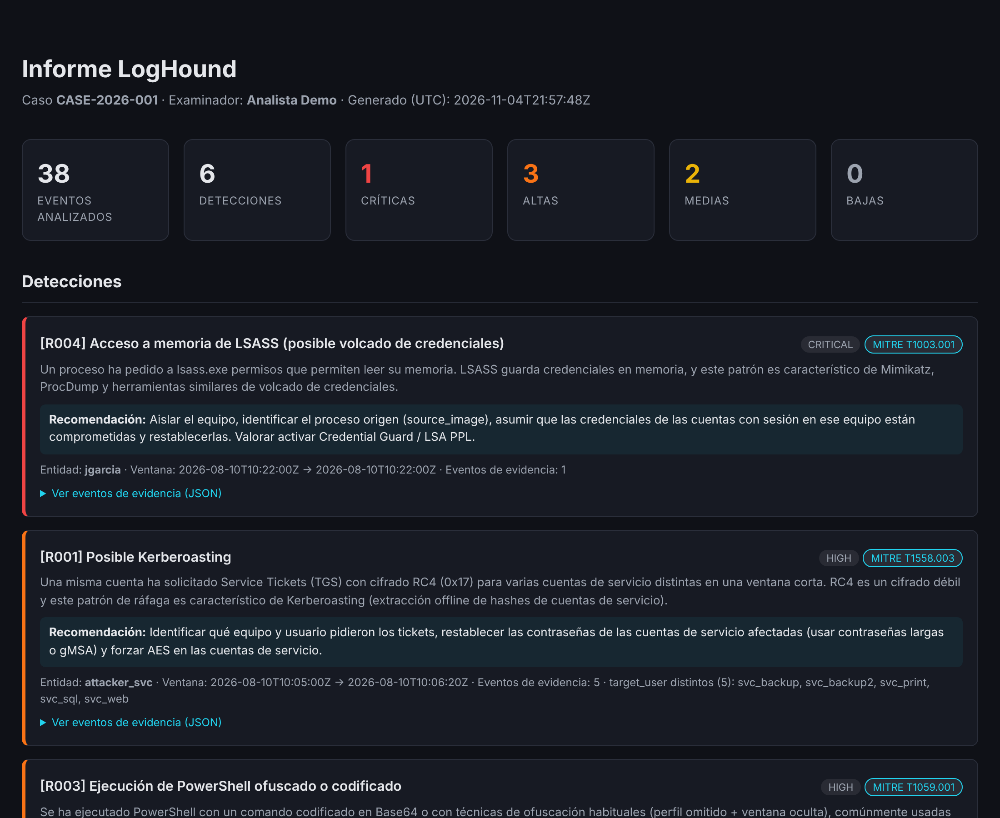

# LogHound 🐾

[](https://github.com/DanielGit-04/loghound/actions/workflows/tests.yml)


**Analizador forense de logs de Windows con detecciones mapeadas a MITRE ATT&CK y cadena de custodia firmada digitalmente.**

LogHound lee logs de Windows Security y Sysmon (en JSON), aplica reglas de detección y genera un informe HTML con las detecciones, una línea de tiempo y un manifiesto de cadena de custodia que permite demostrar que ni los logs ni el informe se han alterado.



> Informe completo de ejemplo: [`docs/informe_ejemplo.html`](docs/informe_ejemplo.html) (descárgalo y ábrelo en el navegador).

## Qué hace

- **Detecta 6 técnicas ATT&CK** (Kerberoasting, fuerza bruta, PowerShell codificado, volcado de LSASS, movimiento lateral, borrado de logs), con falsos positivos controlados. Cada detección incluye evidencia, enlace a MITRE y recomendación.
- **Línea de tiempo** cronológica de todos los eventos implicados.
- **Cadena de custodia**: SHA-256 de cada log, de las reglas y del informe, registro de acciones y **firma digital Ed25519** del manifiesto.
- **Verificación independiente** con `verify`: comprueba el hash, la firma y que los ficheros no han cambiado.
- **Reglas en YAML**: se añaden o ajustan sin tocar código.

## Instalación

Necesitas Python 3.9 o superior.

```bash
git clone https://github.com/DanielGit-04/loghound.git
cd loghound
python3 -m venv venv
source venv/bin/activate          # en Windows: venv\Scripts\activate
pip install -r requirements.txt
```

## Uso rápido (con los datos de ejemplo incluidos)

```bash
# 1) Crear tu par de claves (una sola vez)
python -m loghound.cli keygen

# 2) Analizar y firmar
python -m loghound.cli analyze \
  --logs sample_data/sample_logs.json \
  --rules rules/detection_rules.yaml \
  --examiner "Tu Nombre" \
  --case-id CASE-2026-001 \
  --output output/report.html \
  --sign-key keys/examiner_private.pem

# 3) Verificar
python -m loghound.cli verify \
  --manifest output/chain_of_custody.json \
  --public-key keys/examiner_public.pem \
  --evidence-dir sample_data \
  --require-signature
```

Resultado: `output/report.html` (informe) y `output/chain_of_custody.json` (manifiesto firmado). Abre el informe en el navegador.

Puedes pasar **varios logs** repitiendo `--logs`. Sin `--sign-key` el análisis funciona igual, pero el manifiesto queda sin firma (ver más abajo).

## Detecciones incluidas

| ID   | Detección                                      | Técnica MITRE | Severidad | Cómo evita falsos positivos |
|------|------------------------------------------------|---------------|-----------|-----------------------------|
| R001 | Posible Kerberoasting                          | T1558.003     | High      | Exige ≥3 servicios *distintos* con RC4; ignora cuentas de equipo (`$`) y `krbtgt` |
| R002 | Fuerza bruta en logon                          | T1110         | Medium    | Umbral por IP y ventana; ignora logons locales (`-`, `::1`) |
| R003 | PowerShell ofuscado/codificado                 | T1059.001     | High      | Debe ser PowerShell **y** llevar Base64 largo o `-nop`+ventana oculta (no salta con `-Encoding`) |
| R004 | Acceso a memoria de LSASS                      | T1003.001     | Critical  | Ruta completa de Sysmon + máscara `GrantedAccess` de lectura; excluye Defender |
| R005 | Logons de red en varios equipos                | T1021.002     | Medium    | Exige ≥3 equipos *distintos*; ignora cuentas de equipo y `ANONYMOUS LOGON` |
| R006 | Borrado del registro de eventos                | T1070.001     | High      | Event IDs 1102 y 104 |

Las detecciones son **indicios que debe validar un analista**, no conclusiones. Los umbrales de las reglas son un punto de partida: ajústalos a tu entorno.

## Formato de log

LogHound trabaja con eventos ya normalizados a JSON: una lista de objetos, o un objeto por línea (JSON Lines). Si tienes `.evtx` reales, conviértelos antes (por ejemplo con `evtx_dump`).

Obligatorios: `timestamp` (ISO 8601: `Z`, offset `+02:00` o sin zona = UTC; admite fracciones de segundo) y `event_id`.

Campos que usan las reglas incluidas:

| Campo | Lo usan | Ejemplo |
|-------|---------|---------|
| `computer`, `user`, `source_ip` | casi todas | `"DC01"`, `"jgarcia"`, `"10.0.0.5"` |
| `logon_type` | R005 | `3` |
| `encryption_type`, `target_user` | R001 (evento 4769) | `"0x17"`, `"svc_sql"` |
| `command_line` | R003 (Sysmon 1) | `"powershell.exe -enc ..."` |
| `source_image`, `target_image`, `granted_access` | R004 (Sysmon 10) | `"C:\\Windows\\System32\\lsass.exe"`, `"0x1fffff"` |

Ejemplo:

```json
{"timestamp": "2026-08-10T09:15:32Z", "event_id": 4625, "computer": "DC01",
 "user": "administrator", "source_ip": "10.0.0.15", "logon_type": 3}
```

## Cadena de custodia: qué garantiza (y qué no)

El manifiesto `chain_of_custody.json` contiene los hashes SHA-256 de los logs, las reglas y el informe, el registro de acciones, un hash del propio manifiesto y, si se firmó, una firma Ed25519.

| Capa | Qué demuestra | Límite |
|------|---------------|--------|
| Hash del manifiesto | Detecta cambios accidentales | Quien lo edite puede recalcularlo: **no** prueba que nadie lo manipulara a propósito |
| Firma Ed25519 | Solo quien tiene la clave privada pudo generar ese manifiesto | Hay que contrastar la clave pública por un canal independiente (`--public-key`) |
| Hashes de informe y logs | Cualquier cambio posterior en esos ficheros se detecta con `verify` | Los logs originales hay que conservarlos y aportarlos (`--evidence-dir`) |

Sin `--public-key`, `verify` solo comprueba que la firma es coherente con la clave incluida en el manifiesto y lo avisa: un atacante podría haber firmado con su propia clave. Con la clave pública de confianza del examinador, esa falsificación se detecta.

El informe HTML no puede contener su propio hash (cambiaría al escribirlo); por eso el hash del informe está en el manifiesto, que se genera justo después.

>  La clave **privada** (`keys/examiner_private.pem`) es secreta. El `.gitignore` impide subirla por error. Comparte solo la clave pública.

LogHound es una herramienta de apoyo y de aprendizaje: no sustituye a un procedimiento pericial completo (adquisición forense del disco, sellado de tiempo de confianza, etc.).

## Escribir tus propias reglas

Copia una regla de `rules/detection_rules.yaml`, cambia el `id` y las condiciones:

```yaml
- id: R100
  name: "Cuenta creada fuera de horario"
  mitre: "T1136.001"
  severity: medium
  type: simple              # simple = un evento; threshold = ráfaga en una ventana
  match:
    event_id: 4720
    field_regex:
      user: ['^admin']
    exclude:
      field_equals:
        computer: "DC-PRUEBAS"
  description: "Se ha creado una cuenta con nombre de administrador."
  recommendation: "Confirmar con el equipo de IAM que la creación estaba autorizada."
```

| Condición | Significado |
|-----------|-------------|
| `event_id` | Número o lista de números |
| `field_equals` / `field_in` | Igual a un valor / está en una lista |
| `field_contains` / `field_endswith` | Contiene / termina con alguno de los textos |
| `field_regex` / `field_regex_all` | Casa con alguna / con todas las expresiones regulares |
| `exclude` | Bloque (o lista de bloques) que descarta el evento si se cumple |

Las reglas `threshold` añaden `group_by`, `window_seconds`, `threshold` y, opcionalmente, `distinct_field` + `distinct_threshold` (n.º de valores distintos). LogHound valida las reglas al cargarlas y explica qué falla.

## Tests

```bash
pip install -r requirements-dev.txt
python -m pytest
```

Los 80+ tests cubren el parser (formatos de fecha, zonas horarias, errores), cada regla (aciertos y falsos positivos), la verificación de la cadena de custodia (manipulación del manifiesto, del informe, de los logs, falsificaciones con hash recalculado y con clave ajena) y la seguridad del informe frente a contenido hostil en los logs. Se ejecutan automáticamente en GitHub Actions.

## Estructura del proyecto

```
loghound/
├── loghound/
│   ├── parser.py        # carga y normaliza logs (JSON / JSON Lines, UTC)
│   ├── rules_engine.py  # motor de reglas y validación
│   ├── hashing.py       # cadena de custodia: hashes, firma Ed25519, verificación
│   ├── report.py        # informe HTML (Jinja2) y línea de tiempo
│   ├── cli.py           # comandos keygen / analyze / verify
│   └── templates/report_template.html
├── rules/detection_rules.yaml
├── sample_data/sample_logs.json   # ataque simulado + actividad legítima parecida
├── tests/
├── docs/                          # informe de ejemplo
├── .github/workflows/tests.yml    # integración continua
└── requirements.txt
```

## Hoja de ruta

- [ ] Lectura directa de `.evtx`
- [ ] Exportar las reglas a KQL (Microsoft Sentinel) y Sigma
- [ ] Más reglas: DCSync, Golden Ticket, RDP inusual, exfiltración por DNS
- [ ] Salida STIX/MISP para compartir IOCs
- [ ] Sellado de tiempo de confianza (RFC 3161) del manifiesto

## Aviso legal

Herramienta de análisis forense y defensivo. Úsala únicamente sobre logs de sistemas para los que tengas autorización de análisis: tus propios laboratorios, entornos de práctica autorizados (HTB, TryHackMe…) o entornos corporativos donde tengas mandato. No está pensada para facilitar intrusiones. Los datos de `sample_data/` son ficticios.

## Licencia

MIT — ver [LICENSE](LICENSE). Historial de cambios en [CHANGELOG.md](CHANGELOG.md).
